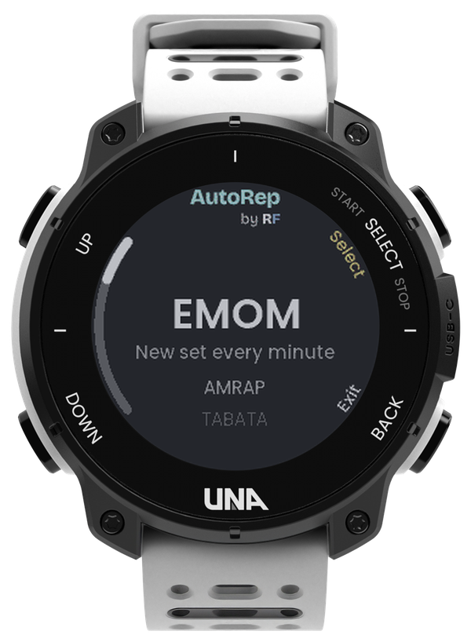
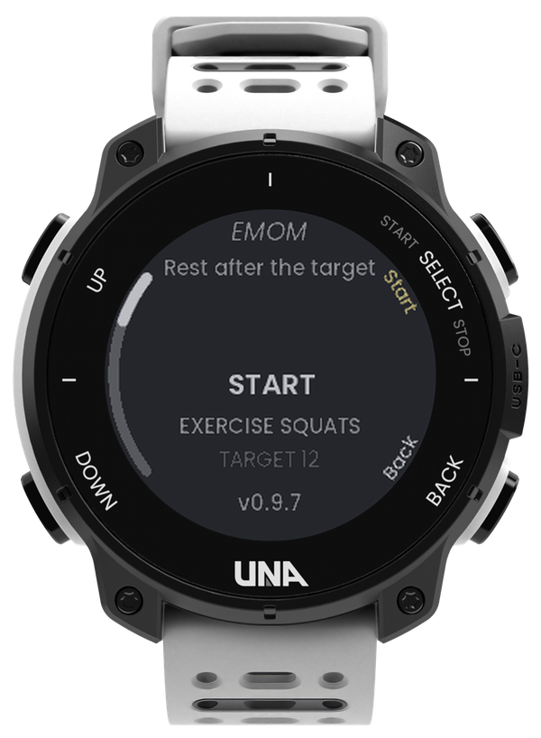
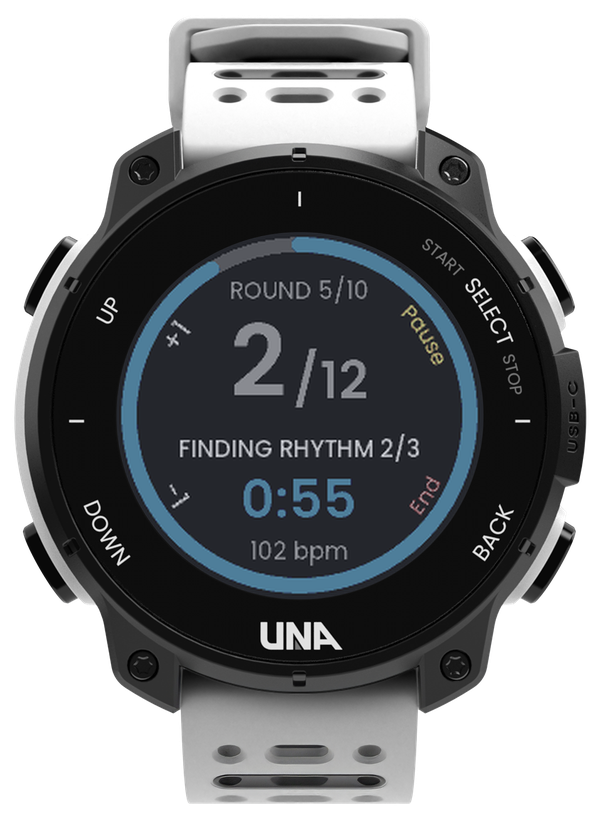
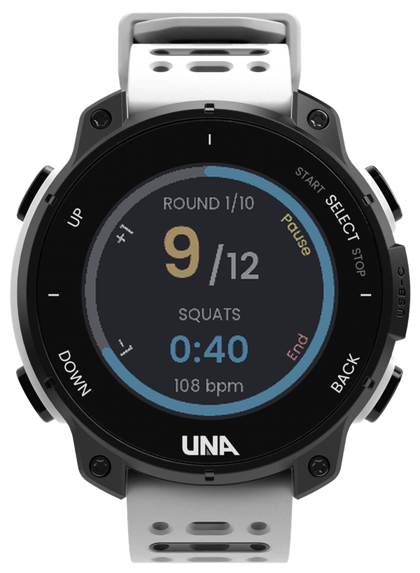
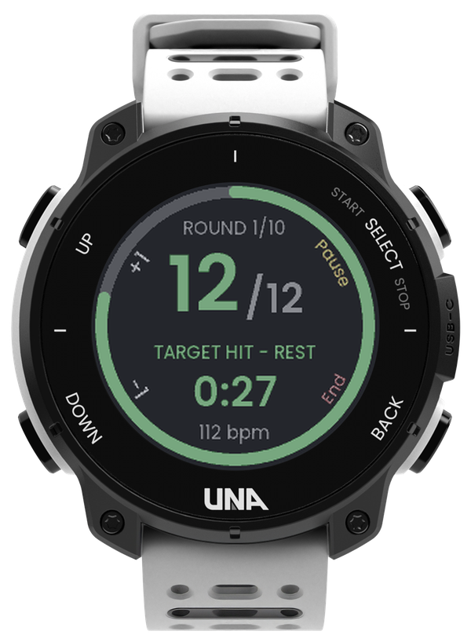
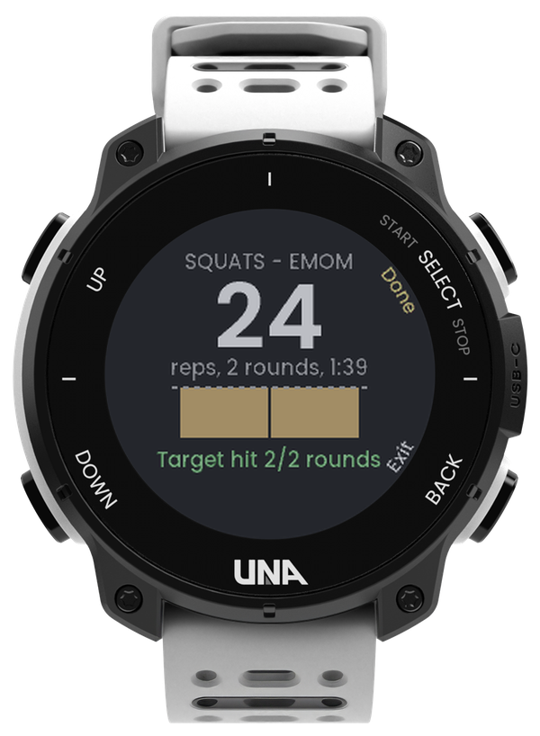

# AutoRep by RF

**Your timer counts seconds. AutoRep counts reps.**

An interval timer for the [UNA Watch](https://unawatch.com) that **counts your reps by itself**, from
the motion of your wrist. It learns your movement from your first three reps, then counts every rep
after them, while it tracks your heart rate and your tempo. EMOM, AMRAP and Tabata, with no tapping
and no phone.

## Demo (30 s)

<!-- To embed the video: edit this file on github.com and drag the .mp4 onto this spot.
     GitHub uploads it and inserts a https://github.com/user-attachments/assets/... link,
     which plays inline. Replace this comment with that link. -->

*Video coming soon.*

## Why

Interval timers tell you when to work, but you still count reps in your head while out of breath,
and the count is gone when the set ends. AutoRep counts for you. In EMOM it buzzes the moment you
hit your target, so the rest of the minute is rest. Afterwards it shows reps per round, your heart
rate and your pace, so you can see where you slowed down.

## What it does

- **Automatic rep counting.** Start the set and move: no button per rep. AutoRep sets its baseline
  on your **first three reps** (their size and rhythm), shows them in grey with "FINDING RHYTHM n/3",
  and counts them all once your rhythm is steady. From then on every rep counts the moment you
  make it.
- **Heart rate** on the workout screen, and saved with every second of the workout.
- **Tempo:** your reps per minute over time, and how much you slowed down from the first rounds to
  the last.
- **Three formats:**
  - **EMOM** (Every Minute On the Minute): do your reps at the start of each minute and rest for
    what is left of it. The watch buzzes when you hit your target.
  - **AMRAP** (As Many Reps As Possible): as many reps as you can in a set time.
  - **Tabata**: rounds of 20 seconds of work and 10 seconds of rest, 8 rounds by default, counted
    round by round so you see exactly where you faded.
- **Exercises:** squats, curls, overhead presses, kettlebell swings and jumping jacks.
- **Get ready, your way:** a 3, 5, 10 or 20 s countdown before the first round, and a double buzz
  that long before each rest ends, then 3-2-1.
- **Miscounted?** L1 and L2 add or remove a rep with one press, even during rest.
- **Remembers your last workout:** open AutoRep and press R1 to start it again.
- **Saved to the UNA phone app:** each workout is an activity with one lap per round, heart rate,
  calories, total reps, reps per lap, and graphs of reps and reps per minute over time.
- **On the watch:** counting and timing need no phone and no account.

## Screens

| Choose a format | Set it up | Finding your rhythm | Counting | Target hit | Summary |
|:---:|:---:|:---:|:---:|:---:|:---:|
|  |  |  |  |  |  |
| EMOM, AMRAP or Tabata | START first: last time's settings are kept | First three reps, in grey, set the baseline | Amber count, heart rate; the ring is the time left | Green: rest until the next minute | Reps per round against the target |

<!-- UNA phone app screenshot goes here:

-->

**Buttons:** L1 / L2 = up / down (during a workout: +1 / −1 rep), R1 = select (during a workout:
pause), R2 = back (during a workout: hold to end). The app opens with a short "by RF" mark; any
button skips it.

## How the counting works

The watch reads its accelerometer and gyroscope 50 times a second. For each exercise it uses the
sensor that swings exactly once per rep: acceleration for squats and presses, rotation for curls,
kettlebell swings and jumping jacks.

1. **Filter** out gravity drift and hand tremor.
2. **Find the main direction** of the movement as you go. This lets AutoRep work on either wrist,
   however the strap sits.
3. **Set the baseline on your first three reps:** how big your reps are and how fast you go. They
   count only once three in a row keep a steady pace, then all three are added at once. Picking up
   the weight, reaching for water or fidgeting doesn't count.
4. **Count a rep** each time the motion swings fully up and down along that direction, past a
   threshold that follows the size of your recent reps, so it adapts as you tire.

**Tested:** on 300 simulated sets per exercise (random speed, depth, fatigue, pauses, strap position
and sensor noise), the count is within one rep of the truth in every clean set, and standing still
for 30 s adds zero false reps. On a real wrist, squats count once the rhythm locks on, the buzzes
and the phone-app activity work. The other exercises are tuned on the simulator so far.

## Coming next

- **Workout plans, set from the watch:** chain several blocks into one workout (for example EMOM
  5 min of squats, rest 60 s, Tabata jumping jacks, rest 60 s, AMRAP 5 min of curls), each with its
  own format, exercise, target and rest. Built on the watch with the same lists, run as one
  activity, with a summary per block.

---

Made by RF for [UNA's first app competition](https://dev.unawatch.com/t/announcing-unas-first-app-competition-october-2026/113)
(October 2026). The watch renders come from the UNA SDK's UI resource pack, shown in the colours of
the real watch screen.
