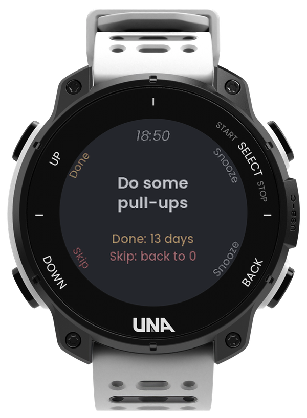
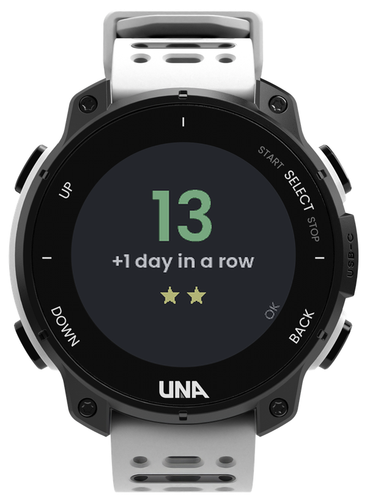
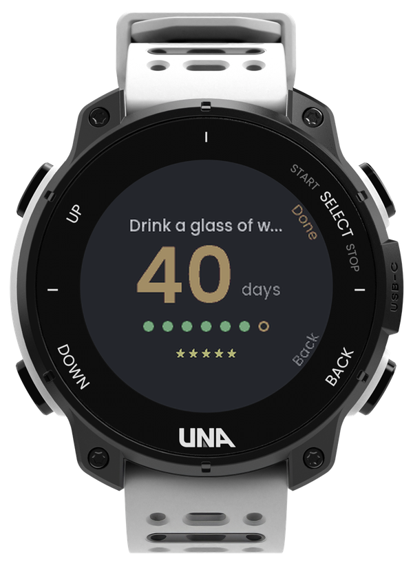
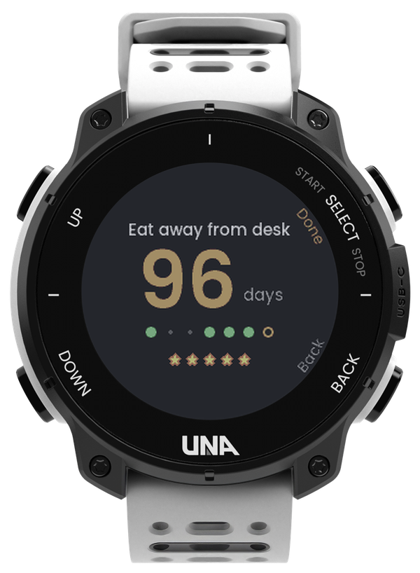
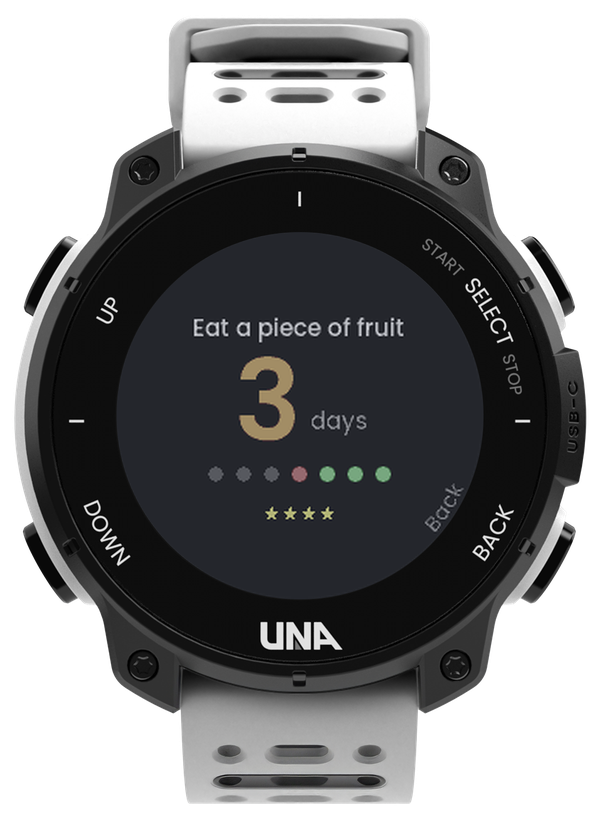
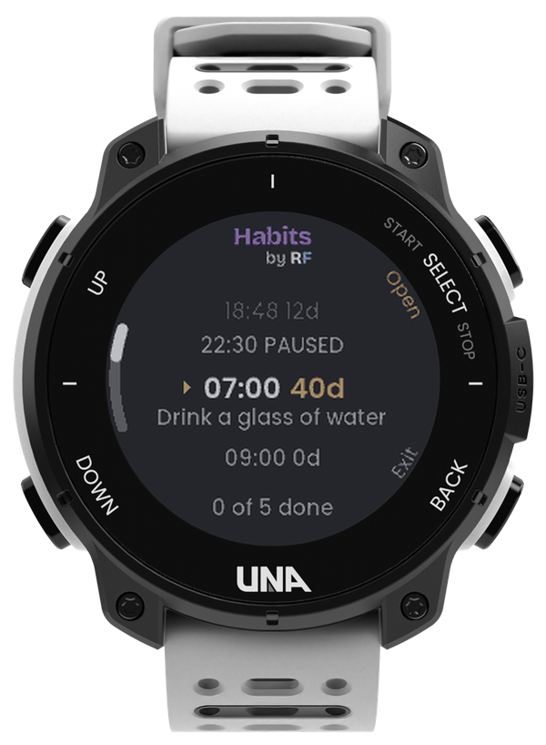

# HabitsTracker by RF

**A streak calculator on your wrist: before you press, it shows what Done earns and what a Skip costs.**

A habit tracker for the [UNA Watch](https://unawatch.com). At the time you pick, your wrist taps
you with what to do now, and the price of each answer: "Done: 13 days" or "Skip: back to 0".

## Demo (30 s)

<!-- To embed the video: edit this file on github.com and drag the .mp4 onto this spot.
     GitHub uploads it and inserts a https://github.com/user-attachments/assets/... link,
     which plays inline. Replace this comment with that link. -->

*Video coming soon.*

## Why

Most habit apps count your streak after the fact. The moment that decides it is earlier: the
reminder, when "later" is one press away. HabitsTracker puts the streak in that moment. Done shows
the number you're about to reach; Skip shows it going back to 0. And the button you press without
thinking only snoozes, so a streak never ends by reflex.

## What it does

- **A nudge at the right time.** When a habit is due, the watch buzzes, chimes and lights up with
  what to do now, in big letters. Under it, the price of each answer: "Done: 13 days" in amber,
  "Skip: back to 0" in red. The app doesn't need to be open.
- **Done, Snooze or Skip.** L1 marks it done. R1 or R2 snoozes it for 5 minutes, up to 3 times;
  after that it skips itself. So the reflex press only says "not now": Done is a choice. Skip
  needs a hold on L2, so it never happens by accident.
- **Your streak, big.** Open a habit to see its streak in big numbers, and the last 7 days as
  dots: green done, red missed, an amber ring for today (small dots are days it isn't due). Press
  R1 when you've already done it: no reminder that day. Hold R2 to pause or resume its reminder.
- **Stars you keep.** Stars come from your best streak, at 3, 7, 14, 21 and 30 days, so a missed
  day never takes one away. Then each star grows an orange border, one every 15 days, then a blue
  one, one every 30 days, and it keeps counting after that.
- **Your day at a glance.** The home screen lists your habits by time of day with each streak,
  what's done and what's paused, and how many of today's are done.
- **Set up on your phone.** Type up to 5 habits in the app's settings in the UNA phone app: what
  to do, the time and the days (every day, weekdays, weekends, one day of the week, or once).
  Nothing to type on four buttons.

## Screens

| Reminder | Done! | Your streak | Stars | A missed day | Your habits |
|:---:|:---:|:---:|:---:|:---:|:---:|
|  |  |  |  |  |  |
| What to do now, and what Done and Skip do to the streak | The new streak; crossing a star says so | 40 days in a row, the week as dots, 5 stars | 96 days on a weekday habit: stars with orange borders, small dots for weekends | 3 days after a miss (the red dot); the stars stay | Habits by time of day with their streaks, and "0 of 5 done" |

**Buttons:** L1 / L2 = up / down, R1 = open, R2 = back / exit. On a habit: R1 = Done, hold R2 to
pause or resume. On a reminder: L1 Done, R1 or R2 Snooze, hold L2 to Skip. On "Done!": R2 OK, or
it closes by itself after 2 seconds.

## How it works

- Your habits come from the app's settings in the UNA phone app (5 habits: what to do, the time as
  HH:MM, and the days; an optional "instead of" field is for your own notes). The watch keeps its
  own copy with the streaks, and picks up changes from the phone within a minute. Changing what a
  habit is starts its streak over; changing its time or days keeps it.
- The app's background service starts with the watch and checks the time about once a minute.
  When a habit is due and not done yet today, it buzzes, plays a short two-note chime, lights the
  screen and opens the reminder.
- Snoozes are kept by the service, not the screen, so a reminder survives the screen going dark.
  After the third snooze the habit is skipped for the day and the reminder closes itself.
- A streak counts the days the habit is due: a weekday habit doesn't lose its streak over the
  weekend. Days follow the watch's own clock and calendar. The watch also keeps each habit's best
  streak, which is where the stars come from.

**Tested:** earlier versions on a real watch, installing from the store and setting habits from
the phone. Version 0.3.0 in the simulator: reminders at their time, Done, Snooze and Skip, Done
before the reminder, streaks after a missed day, paused habits, and every star level.
<!-- TODO(RF): add what you confirmed on your wrist with 0.3.0 (the buzz + chime at the set time). -->

## Feedback

Found a bug, or have an idea? [Open an issue](https://github.com/ROunofF/una-apps/issues/new/choose)
and pick **HabitsTracker** in the form.

---

Made by RF for [UNA's first app competition](https://dev.unawatch.com/t/announcing-unas-first-app-competition-october-2026/113)
(October 2026). The watch renders come from the UNA SDK's UI resource pack, shown in the colours of
the real watch screen.
