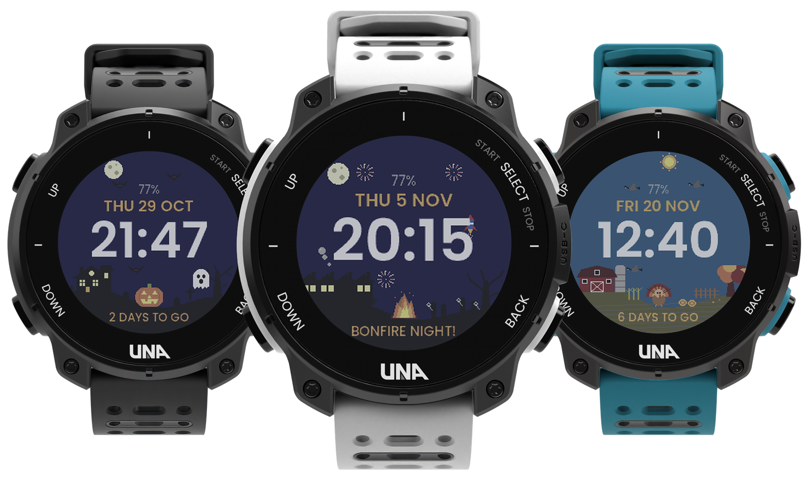
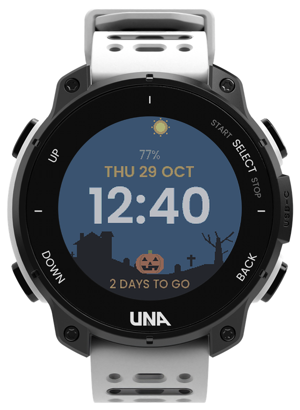
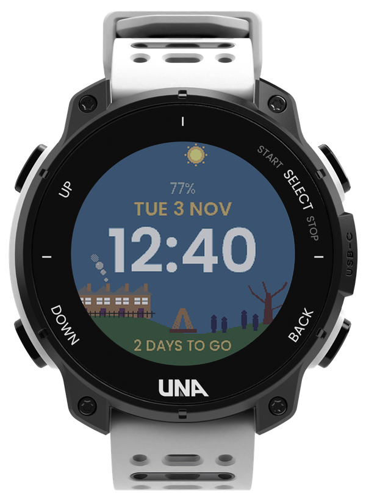
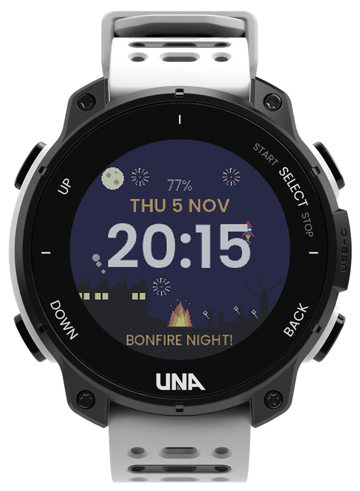
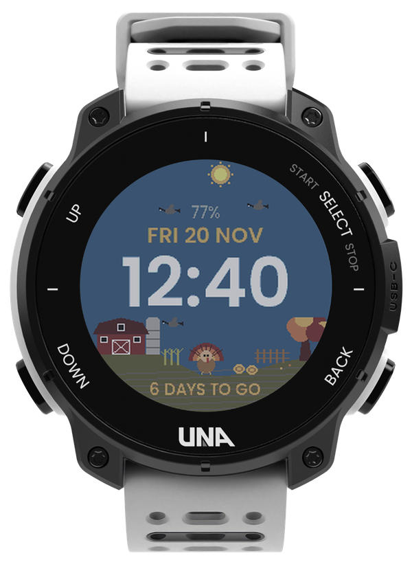
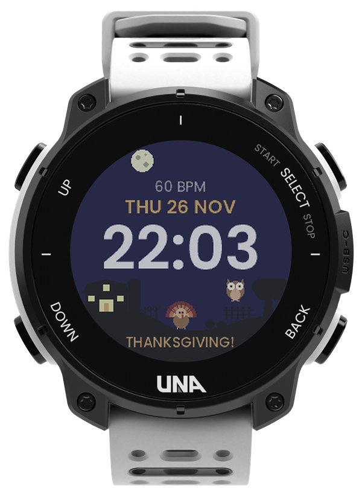

# Theme (Halloween!) Face by RF

**A watch face that follows the seasons.**

A watch face for the [UNA Watch](https://unawatch.com): a pixel-art scene for the next holiday, under a
sky that follows your day. It counts down to the holiday, and a few days after it the next one takes
over by itself.

## Demo

https://github.com/user-attachments/assets/ca5513d0-5b20-4045-9863-e73b18d341a2

Halloween night, Bonfire Night, then a Thanksgiving day, more coming...: every minute the scene comes alive for a
few seconds.

## Why

The watch face is the screen you see most, so it's a good place for a little seasonal fun. This one
looks like a pixel-art holiday scene but still reads like a normal face: big time, the date, and two
lines you choose. And you never have to change it: it moves on to the next holiday by itself.

## What it does

- **Three holidays so far:**
  - **Halloween** (October 31): a haunted hill. At dusk the windows light up, the jack-o'-lantern
    glows and the bats come out; at night a ghost haunts the dead tree.
  - **Bonfire Night** (November 5, UK): a park by a terrace of houses, smoke rising from a chimney.
    After dark the bonfire is lit, sparklers glow, fireworks burst over the rooftops and rockets
    shoot up.
  - **Thanksgiving** (US, 4th Thursday of November): a farm in autumn colours, geese flying over by
    day, the barn lit after dark and an owl on the fence at night.
- **Changes theme by itself.** Each theme counts down to its day ("6 DAYS TO GO", then
  "BONFIRE NIGHT!"), and 5 days later the next one appears as a surprise. When two holidays are
  closer than that, it switches halfway between them.
- **A sky that follows your day:** blue by day, a coloured dusk, navy at night, lavender at dawn.
  The sun and the moon cross the sky along the edge of the screen.
- **A little motion:** every minute, and when the face comes back on screen, the bats, geese or
  fireworks fly for 2 seconds, then the scene stays still.
- **On the face:** the time, large, in your watch's 12 or 24 hour format; the date, in your watch's
  day and month order; two info lines.
- **Settings in the UNA app** (More → Store → My Apps → Theme (Halloween!) Face by RF → CONFIGURE APP):
  - **Theme:** automatic, or keep one theme all year.
  - **Top line, bottom line:** battery (red below 20%), steps, active minutes, heart rate, or the
    countdown. Battery and countdown by default.
- **Easy on the battery:** it only turns on the sensors your two lines show, and only moves for a
  few seconds each minute.

## Screens

| Halloween night | Halloween day | Bonfire Night, by day |
|:---:|:---:|:---:|
|  |  |  |
| Moon, bats, a ghost by the tree | Sun over a quiet house | Smoke rising from a chimney |

| Bonfire Night | Thanksgiving day | Thanksgiving night |
|:---:|:---:|:---:|
|  |  |  |
| Fireworks, a rocket, the bonfire lit | Geese over the farm, the countdown | Heart rate on the top line, an owl |

**Buttons:** none. A watch face has no buttons of its own; the watch's buttons work as usual.

## How it works

The theme comes from the date: the face finds the next holiday, and keeps the last one on for 5 days
after it. The scene comes from the hour: day 7 am to 5 pm, dusk to 8 pm, night to 5 am, then dawn.
The bats, geese and fireworks land on new spots each minute, picked from the time, so the face needs
no memory and nothing runs between flights.

The face's background service reads only what your two lines show: battery, steps, active minutes,
or heart rate. Heart rate keeps the sensor on, so choose it only if you want it. Your settings come
from the UNA app and are read again every 5 minutes.

All the art is pixel art drawn in the watch's own 64 colours, so it looks the same on the watch as
in these pictures.

**Tested:** version 1.0.0 (Halloween) on a real UNA Watch. Version 1.1.0 (Bonfire Night,
Thanksgiving, settings) in the simulator, with each holiday's dates, every time of day and every
info line; steps and active minutes can only be checked on the watch.

## Coming next

- **A theme for each season:** Christmas next, then one more each month through the year.

## Feedback

Found a bug, or have an idea? [Open an issue](https://github.com/ROunofF/una-apps/issues/new/choose)
and pick **Theme (Halloween!) Face** in the form.

---

Made by RF for [UNA's first app competition](https://dev.unawatch.com/t/announcing-unas-first-app-competition-october-2026/113)
(October 2026). The watch renders come from the UNA SDK's UI resource pack, shown in the colours of
the real watch screen.
