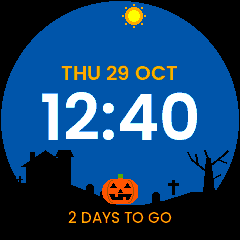
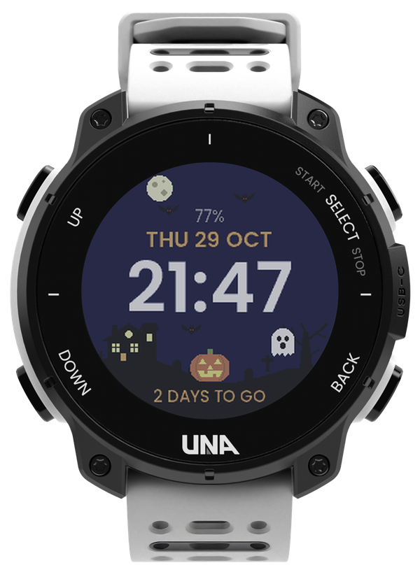
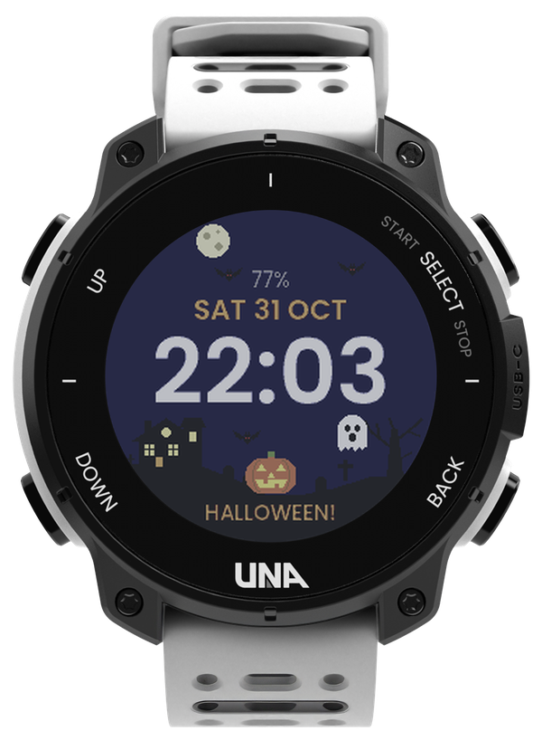
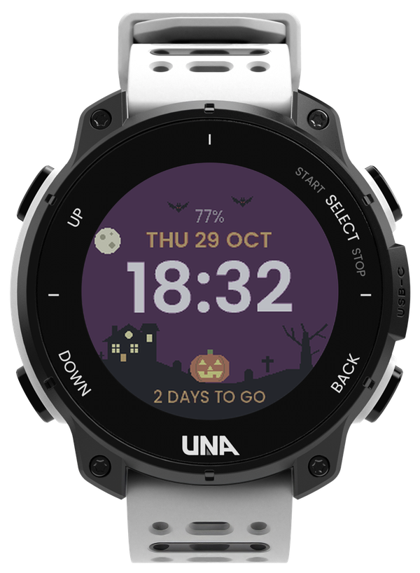
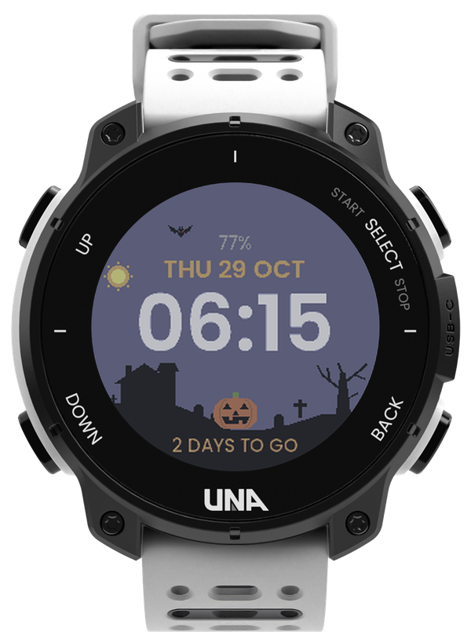
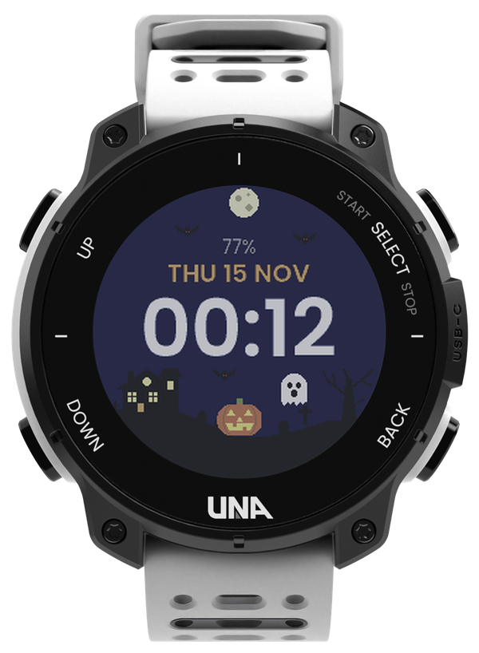

# Theme (Halloween!) Face by RF

**A haunted hill under a sky that follows your day.**

A Halloween watch face for the [UNA Watch](https://unawatch.com): the scene changes from morning to
night, and in October it counts down to Halloween.

## Demo

The face through a day: the bats and the ghost fly to a new spot every minute.

## Why

A watch face is the screen you see most, so it's a good place for a little seasonal fun. This one
looks like a pixel-art Halloween scene but still reads like a normal face: big time, the date and the
battery level. It only moves for 2 seconds each minute, so it's light on the battery.

## What it does

- **A sky that follows your day.** In the morning the sun rises over a quiet house and a carved
  pumpkin. At dusk the sky turns purple, the windows light up, the jack-o'-lantern glows and the
  bats come out. At night the moon crosses the sky and a ghost haunts the dead tree.
- **A little motion.** Every minute the bats and the ghost fly to a new spot, then stay still.
- **On the face:** the time, large, in your watch's 12 or 24 hour format; the date, in your watch's
  day and month order; the battery level (red below 20%).
- **In October,** a countdown to Halloween ("2 DAYS TO GO"), and "HALLOWEEN!" on the 31st.
- **Easy on the battery:** it reads no heart rate or other sensors.

Set it in **Settings > Watch Face > Halloween**.

## Screens

| Night | Halloween | Dusk |
|:---:|:---:|:---:|
|  |  |  |
| 8 pm to 5 am: moon, bats and a ghost | On the 31st it says "HALLOWEEN!" | 5 to 8 pm: purple sky, lit windows |

| Day | Dawn | November |
|:---:|:---:|:---:|
|  |  |  |
| 7 am to 5 pm: blue sky, unlit house | 5 to 7 am: a lavender sky | After Halloween the countdown hides |

**Buttons:** none. A watch face has no buttons of its own; the watch's buttons work as usual.

## How it works

The scene is picked from the hour: day, dusk, night or dawn. The sun and moon move along an arc near
the edge of the screen. Each minute, the face picks new spots for the bats and the ghost from the
time and flies them there for 2 seconds; the rest of the time nothing redraws except the clock.
The face's background service only listens for the battery level. All the art is pixel art drawn
in the watch's own colours, so it looks the same on the watch as in these pictures.

Tested on a real UNA Watch (version 1.0.0).

## Coming next

- **Monthly themes:** a new scene for each season's holiday, starting with November and December.
  Each one counts down to its day, then the next one takes over.

## Feedback

Found a bug, or have an idea? [Open an issue](https://github.com/ROunofF/una-apps/issues/new/choose)
and pick **Theme (Halloween!) Face** in the form.

---

Made by RF for [UNA's first app competition](https://dev.unawatch.com/t/announcing-unas-first-app-competition-october-2026/113)
(October 2026). The watch renders come from the UNA SDK's UI resource pack, shown in the colours of
the real watch screen.
