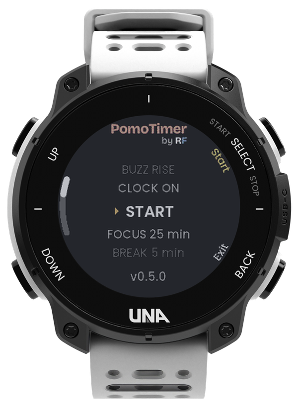
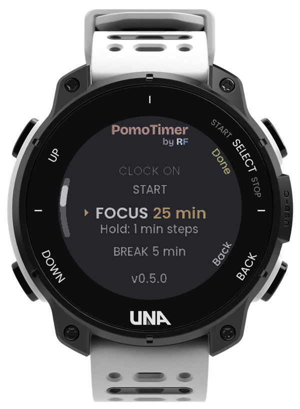
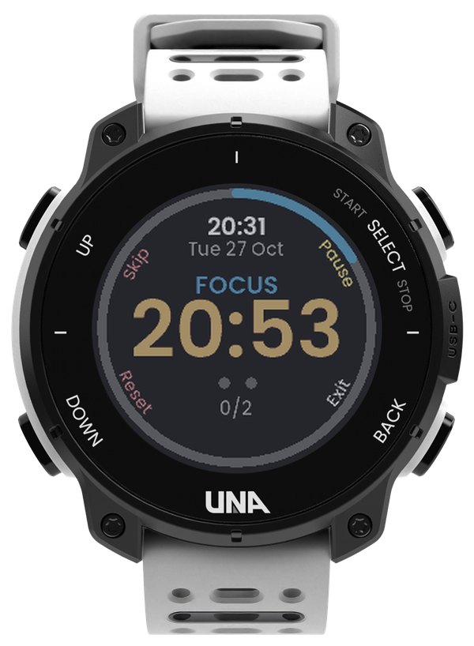
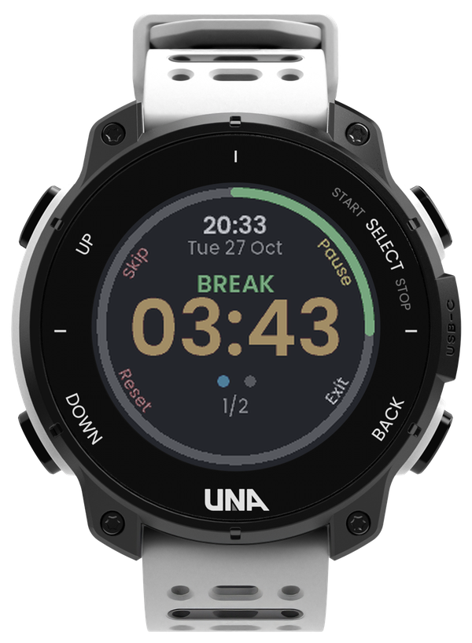
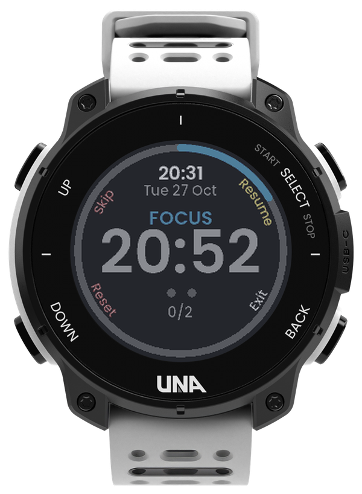
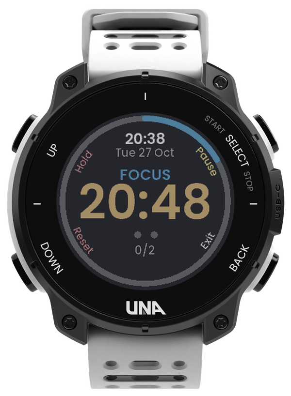

# PomoTimer by RF

**Your wrist keeps time, so you can keep focus.**

A focus timer for the [UNA Watch](https://unawatch.com), built on the Pomodoro technique: focus in
timed sessions, take short breaks, and get a longer break after every set of sessions, without
reaching for your phone.

## Demo (30 s)

<!-- To embed the video: edit this file on github.com and drag the .mp4 onto this spot.
     GitHub uploads it and inserts a https://github.com/user-attachments/assets/... link,
     which plays inline. Replace this comment with that link. -->

*Video coming soon.*

## Why

A timer on your phone pulls you back to the phone, the thing you were trying to put down. On your
wrist, the timer stays out of the way: a buzz tells you when focus ends and the break starts, and
when it's time to get back to work, so you never have to check.

## What it does

- **Starts in one press.** PomoTimer opens on START with your last focus and break lengths, so R1
  gets you going straight away.
- **Tells you without looking.** The watch vibrates and lights up when a phase ends: a buzz that
  builds up when focus is over, a double tap when the break is.
- **Never loses your session.** The timer keeps running after you leave the app. Open it again and
  you are back on the countdown.
- **At a glance:** a ring fills as the phase runs, blue for focus and green for breaks. Dots show
  where you are in the set. The time of day and the date show on the timer screen.
- **Hard to tap by accident.** Skip and Reset need a hold, and when the screen is dark the first
  press only wakes it.
- **Adjustable:** focus from 5 to 60 minutes (tap for 5-minute steps, hold to count by 1), breaks
  from 1 to 30. A set is 1 to 4 focus sessions (2 by default), then a long break three times the
  short one. The focus-end buzz can be rising, long or soft.

## Screens

| Start | Focus length | Focus |
|:---:|:---:|:---:|
|  |  |  |
| Last time's settings: R1 starts | Tap for 5 min, hold for 1 | The ring fills, the dots count the set |

| Break | Paused | Hold to skip |
|:---:|:---:|:---:|
|  |  |  |
| Green for breaks; a long one after each set | The countdown turns grey | A tap only says "Hold" |

**Buttons:** on the start screen, L1 / L2 = up / down, R1 = start (or edit a setting, then Done),
R2 = exit. On the timer, R1 = pause / resume, hold L1 = skip to the next phase, hold L2 = reset,
R2 = exit (the timer keeps running). The app opens with a short "by RF" mark; any button skips it.

## How it works

The timer runs in the app's background service, not on the screen, so it keeps counting when you
leave the app and buzzes at the end of each phase even when the screen is off. The screen only
shows the service's countdown. Your settings are saved on the watch for next time.

## Coming next

- **A smoother timer face:** the ring fills pixel by pixel, with a dot that laps it once a minute,
  so you can see time moving at a glance.

## Feedback

Found a bug, or have an idea? [Open an issue](https://github.com/ROunofF/una-apps/issues/new/choose)
and pick **PomoTimer** in the form.

---

Made by RF for [UNA's first app competition](https://dev.unawatch.com/t/announcing-unas-first-app-competition-october-2026/113)
(October 2026). The watch renders come from the UNA SDK's UI resource pack, shown in the colours of
the real watch screen.
