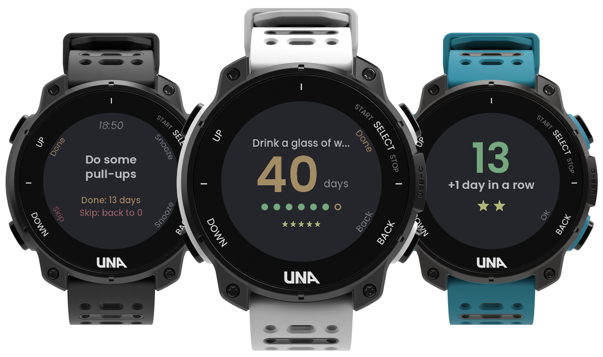
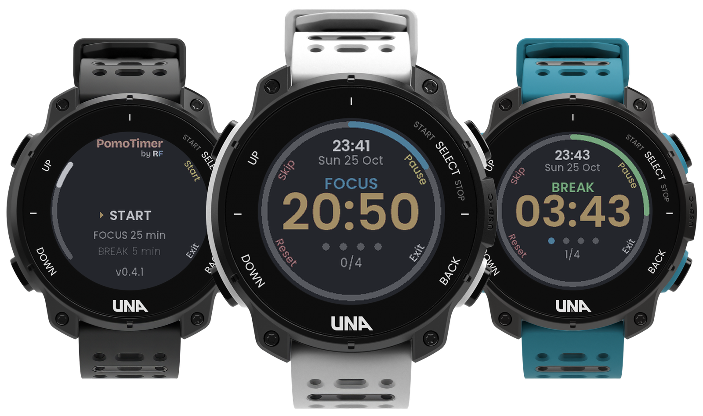

# RF's apps for the UNA Watch

Home of my [UNA Watch](https://unawatch.com) apps: what each one does, its screens, what's coming
next, and the place to report a bug or send an idea. They are also my entries for
[UNA's first app competition](https://dev.unawatch.com/t/announcing-unas-first-app-competition-october-2026/113)
(October 2026).

## Feedback

Using one of my apps? I'd like to hear from you. Each form asks which app it's about.

- [**Report a bug**](https://github.com/ROunofF/una-apps/issues/new?template=1-bug.yml): something doesn't work the way it should.
- [**Suggest an idea**](https://github.com/ROunofF/una-apps/issues/new?template=2-idea.yml): something you'd like an app to do, or a new app.
- [**Send feedback or ask a question**](https://github.com/ROunofF/una-apps/issues/new?template=3-feedback.yml): what works for you, what's confusing.

You need a free GitHub account to post. [Open issues](https://github.com/ROunofF/una-apps/issues)
show what's already reported, so check there first and add a 👍 to the ones you also want.

## Apps

| App | What it does |
|---|---|
| [**AutoRep by RF**](AutoRep/) | A Sets / EMOM / AMRAP / Tabata timer that counts your reps automatically from wrist motion (baseline set on your first 3 reps), with heart rate and tempo. Coming in 1.1: plan workouts on your phone with the [**workout builder**](https://rounoff.github.io/una-apps/AutoRep/builder/). |
| [**HabitsTracker by RF**](HabitsTracker/) | A streak calculator on your wrist: at the time you pick, the watch buzzes with what to do and what each answer does to your streak ("Done: 13 days", "Skip: back to 0"). Big streaks, a week of dots, and stars you keep. Set up on your phone. |
| [**PomoTimer by RF**](PomoTimer/) | A Pomodoro focus timer: timed focus sessions and breaks, a buzz at every change, a long break after each set, and it keeps running when you leave the app. |
| [**Theme (Halloween!) Face by RF**](HalloweenFace/) | A watch face that follows the seasons: a pixel-art scene for the next holiday (Halloween, Bonfire Night, Thanksgiving so far) under a sky that follows your day, with a countdown, and the next theme taking over by itself. Info lines set in the UNA app. |

