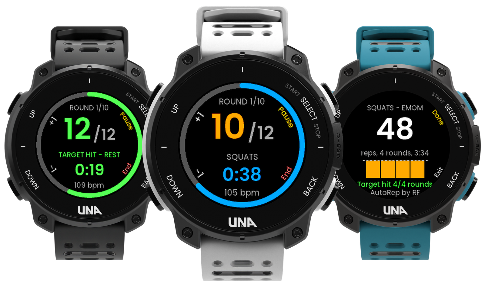

# UNA Watch app submissions

My entries for [UNA's first app competition](https://dev.unawatch.com/t/announcing-unas-first-app-competition-october-2026/113)
(October 2026).

| App | What it does |
|---|---|
| [**AutoRep by RF**](AutoRep/) | A Sets / EMOM / AMRAP / Tabata timer that counts your reps automatically from wrist motion (baseline set on your first 3 reps), with heart rate and tempo. |

